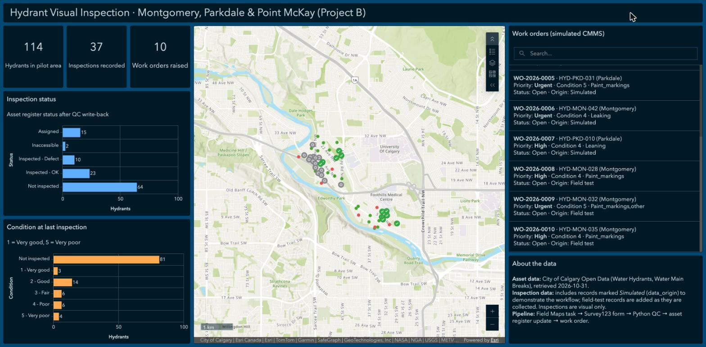
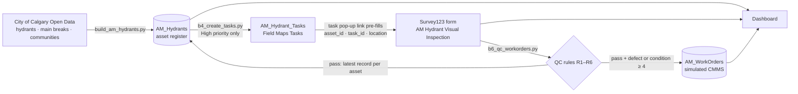
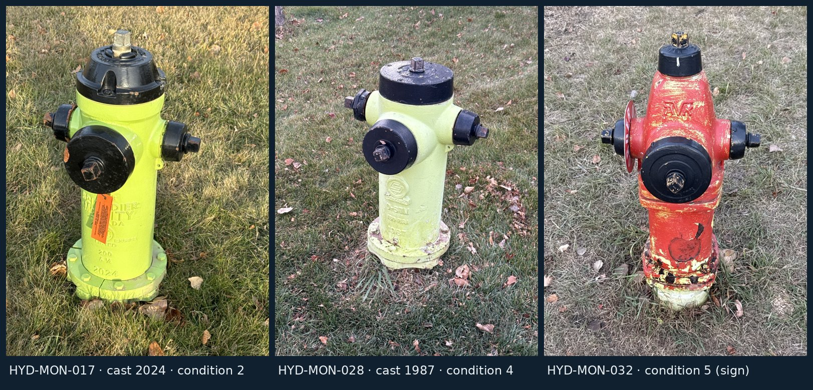

# Project B: Hydrant Visual Inspection, from Field Task to Work Order

This is an end-to-end asset-management workflow on ArcGIS Online. It covers 114 fire hydrants in three Calgary communities: Montgomery, Parkdale and Point McKay.

The workflow follows one inspection loop:
1. Plan and assign the inspection.
2. Inspect in the field.
3. Check the record (QC).
4. Update the asset register.
5. Raise a work order.

Utilities run the same loop in a CMMS (Computerized Maintenance Management System). Here, a hosted table stands in for the CMMS.

> **Status (2026-11-03):** the pipeline is built and tested end to end. It was first run with labelled **simulated** inspections. On 2026-11-03 it was used for a real **field test** of 5 hydrants in Montgomery: all 5 records passed QC, updated the register and raised 3 work orders.



## Workflow



## Components
All items are in the ArcGIS Online folder `ProjectB_AM`.

| Item | Type | Role |
|---|---|---|
| AM_Hydrants | Hosted feature layer | Asset register (114 hydrants). Attribute-only editing, editor tracking and offline sync are on. |
| AM Hydrant Visual Inspection | Survey123 form and its hosted feature layer, with `_form` and `_results` views | Inspection records, with photo attachments |
| AM_Hydrant_Tasks | Hosted feature layer, task-enabled | Field Maps Tasks: one task per High-priority hydrant |
| AM_WorkOrders | Hosted table | Work orders raised from inspections that pass QC |
| ProjectB_Hydrant_Inspection_Map | Web map | Holds the hydrants, inspections, tasks and the work-order table. Arcade pop-ups show the latest inspection for each hydrant. |
| AM Hydrant Inspection Dashboard | ArcGIS Dashboards | Indicators, status and condition charts, a map and the work-order list |

## Data
- **Sources.** All data comes from City of Calgary Open Data through the SODA API, retrieved 2026-10-31:
  - Water Hydrants (`5qgc-b482`)
  - Water Main Breaks (`dpcu-jr23`)
  - Community District Boundaries (`surr-xmvs`)
- **Real attributes only.** The register uses only what the City publishes: location, `city_globalid`, owner, status and rotation. No install year or model is made up.
- **Inspection priority is a proxy.** It counts water-main breaks within 200 m since 2016:
  - High: 3 or more breaks (26 hydrants)
  - Medium: 1–2 breaks (48 hydrants)
  - Low: no breaks (40 hydrants)
- **Simulated data is labelled.** Every demo inspection has `data_origin = "Simulated"`, and its notes start with "SIMULATED". Simulated task completions are labelled the same way, and the dashboard says so on screen. Real inspections have `data_origin = "Field test"`.

## Results (as of 2026-11-03)
- **Tasks.** 26 High-priority tasks were created.
  - 6 tasks outside Montgomery were completed with simulated inspections.
  - 5 tasks in Montgomery were completed in the field test.
  - 15 tasks stay open.
- **QC.** 37 inspections were checked: 32 simulated and 5 field test.
  - 35 passed.
  - 2 failed. Both failures are simulated test cases planted on purpose (rules R4 and R2).
  - All 5 field-test records passed. This included the first real check of R5, which confirms that a defect has a photo attached.
- **Register after write-back:**
  - Inspected - OK: 23
  - Inspected - Defect: 10
  - Inaccessible: 2
  - Assigned: 15
  - Not inspected: 64
- **Work orders.** 10 in total: 6 Urgent and 4 High.
  - 3 come from the field test: WO-2026-0008 (High), WO-2026-0009 (Urgent) and WO-2026-0010 (High).

Details are in [`docs/qc_report_2026-11-02.md`](docs/qc_report_2026-11-02.md) (simulated run) and [`docs/qc_report_2026-11-03.md`](docs/qc_report_2026-11-03.md) (after the field test).

## Field test findings (2026-11-03)
Five High-priority hydrants in Montgomery were inspected on foot in about 30 minutes, using the SOP.



1. **Age matters, and the open data doesn't show it.**
   - HYD-MON-017 and HYD-MON-021 are cast **2024** and look nearly new (condition 2 and 3).
   - HYD-MON-028 is a Concord D-67M cast **1987**. Its paint is peeling in layers on the barrel and base flange (condition 4).
   - The City's open data has no install year, so a field visit is the only way this pilot can capture it. Adding `install_year` and `manufacturer` to the register is an obvious next step.
2. **A pattern worth checking (not verified).** Both 2024 hydrants sit in an area with 4 water-main breaks within 200 m since 2016. They may have been replaced during recent repair work. This is a hypothesis to check against City capital-works records, not a finding.
3. **HYD-MON-032 carries a sign reading "OUT OF ORDER"** on its side outlet. Following the SOP, it was rated condition 5 and raised an **Urgent** work order. The sign shows the City already knows; the inspection records the hydrant's current state.
4. **The priority rule was reviewed.** HYD-MON-028 and HYD-MON-035 have paint-only defects, but because they are rated condition 4 the rule makes them **High** priority, the same level as a hydrant that is leaning. A possible v1.1 rule:
   - cosmetic-only defects (paint, vegetation) → Normal
   - functional defects (leak, damage, missing caps, out of service) → keep the current rule

   **Decision (2026-11-04):** keep the current rule for this pilot. The trade-off is recorded in `docs/decisions.md`; a cosmetic/functional split remains an option for a later version.
5. **Lessons about the form and the process:**
   - Two records were submitted without notes, and one still had a placeholder for the sign text. These were completed in the office on 2026-11-04 from the site photos, and each added note is tagged as an office note.
   - The Asset ID question is hidden, so it can't be checked on site.
   - The general photo question still has its default name, `field_17`.
   - The tasks themselves worked well: every record carried `asset_id` and `task_id`.

## Repository layout
```
ProjectB/
├── README.md
├── data/        # raw Open Data extracts and the AM_Hydrants.csv register
├── scripts/     # Python: build register, tasks, simulation, QC + work orders, dashboard
└── docs/
    ├── SOP_hydrant_visual_inspection.md
    ├── data_dictionary.md
    ├── qc_report_2026-11-02.md
    ├── qc_report_2026-11-03.md
    ├── decisions.md   # decision log (Chinese)
    ├── log.md         # daily work log (Chinese)
    └── img/           # screenshots
```

## How to rerun
1. **Build the register (on your computer).** Run `scripts/build_am_hydrants.py` locally. It needs Python 3 only (standard library) and writes `data/AM_Hydrants.csv`. Publish that CSV as the hosted layer **AM_Hydrants**.
2. **Create the form.** Build the Survey123 form in the web designer. Field names and choices are listed in `docs/data_dictionary.md`.
3. **Run the rest in an ArcGIS Notebook** (Python 3 Standard runtime):
   1. `b4_create_tasks.py` creates the High-priority tasks, marks those hydrants as Assigned and sets up the task pop-up with the Survey123 link.
   2. `b6_simulate_inspections.py` adds the demo data. It refuses to run a second time.
   3. `b6_qc_workorders.py` runs QC, the register write-back and work-order creation. It is idempotent: rerun it after every batch of field inspections.
   4. `b7_create_dashboard.py` creates or updates the dashboard.

## Screenshots (`docs/img/`)
| File | Shows |
|---|---|
| B1_01_fields1–3.png | AM_Hydrants field settings and lists of allowed values (domains) |
| B1_02_settings.png | Editing settings on the layer |
| B1_03_map.png | Register on the map, by inspection priority |
| B3_01_popup.jpg | Hydrant pop-up with the latest inspection and the form link |
| B3_02_form_prefilled.jpg | Survey123 form opened from the pop-up with `asset_id` pre-filled |
| B3_03_task_popup.png | Field Maps (phone): task pop-up with the "▶ Start inspection" link |
| B3_04_form_from_task.png | Survey123 (phone) opened from the task: hydrant location pre-filled, data origin = Field test |
| B5_01…B5_05 (jpg) | Field-test photos: HYD-MON-017, 021, 028 (and flange close-up), 032 |
| B5_06_comparison.jpg | Side by side: a 2024 hydrant, a 1987 hydrant and HYD-MON-032 |
| B7_01_dashboard.jpg | Inspection dashboard (simulated data only, 2026-11-02) |
| B7_02_dashboard_field_test.jpg | Dashboard after the field test, with the field-test work orders in the list (2026-11-03) |

## Limitations
- **Visual inspection only.** There is no flow testing and no operating of hydrants or valves.
- **Priority is a proxy.** It uses nearby main breaks, not the hydrant's age or material, which the City does not publish.
- **Most data is simulated.** 32 of the 37 inspections are simulated and labelled as such, and their condition mix was set by the author. Only the 5 field-test records describe real hydrants.
- **The field-test sample is small and not random.** The 5 hydrants were open High-priority tasks chosen to fit one walking route, inspected in late-afternoon light. They show the workflow working; they are not a condition survey of the area.
- **One person plays every role.** All roles in the SOP are played by the author, with one Field Maps assignee.

## Next steps
- **Improve the form.**
  - Show Asset ID as read-only so it can be checked on site.
  - Rename the photo question from `field_17` to `hydrant_photo`.
  - Make Notes required whenever a defect is reported.
- **Extend the register.** Add `install_year` and `manufacturer` fields, filled from field inspections.
