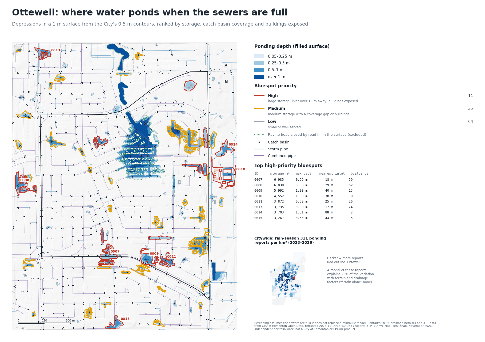
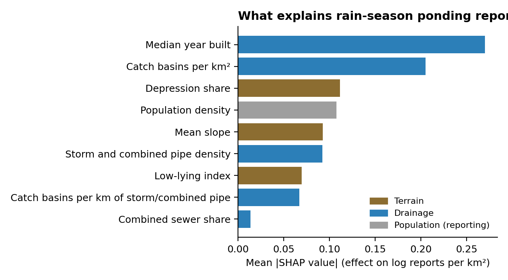
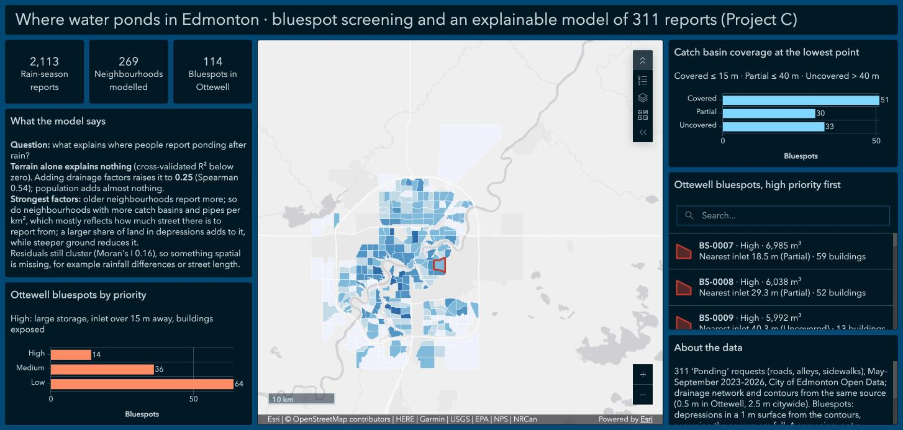
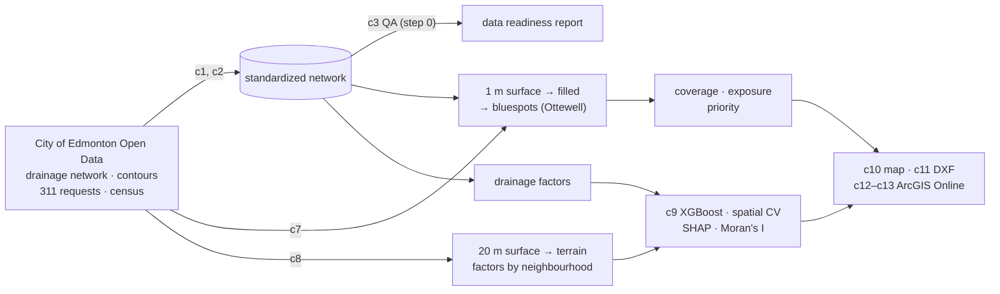

# Project C: Where does water pond in Edmonton when the sewers are full?

**Question.** In older neighbourhoods with combined sewers, heavy rain fills the pipes and the extra water runs over the surface to low points. Where does it collect, are those low points served by catch basins, and what explains where people actually report ponding?

**Why Edmonton and Ottewell.** EPCOR's Stormwater Integrated Resource Plan ranks flood risk across the city, and Ottewell is one of its active flood mitigation projects: new storm sewers since 2024 and a dry pond in Ottewell Park, due by 2027. Within Ottewell, 79% of pipe length is combined sewer, built mostly from the late 1950s to the 1970s.

**Approach.** Two methods that check each other:
- **A. Bluespot screening (physically based).** Where would water pond in Ottewell if the sewers were full?
- **B. Explainable machine learning (data driven).** Across 269 neighbourhoods, which terrain and drainage factors explain rain-season 311 ponding reports?

## Results
**A. Ottewell bluespots** (`scripts/c7_bluespots.py`)
- 1 m surface from the City's 0.5 m contours; depressions found by filling the surface (equivalent to priority-flood).
- **114 bluespots** deeper than 0.15 m and larger than 50 m², holding about **135,800 m³** when full. Three deeper features are ravine channels closed by road fill in the surface (culverts are not in the contours) and are excluded.
- At the lowest point of each bluespot: **51 covered** (catch basin within 15 m), **30 partial** (15–40 m), **33 uncovered** (over 40 m).
- **14 high priority** bluespots (top-quarter storage, inlet more than 15 m from the lowest point, buildings touching): about 51,200 m³ of storage and 251 buildings touching. The catch basins and pipes around them are listed for maintenance and design (`priority_assets_ottewell`, DXF in `cad/`).

**B. What explains ponding reports** (`scripts/c8_terrain_city.py`, `scripts/c9_ponding_model.py`)
- 2,361 rain-season (May–September) 311 "Ponding" reports, 2023–2026; 2,113 of them fall in the 269 modelled neighbourhoods (at least 2 km of drainage pipe and 100 residents). The target is reports per km² of neighbourhood.
- XGBoost with spatial block cross-validation (8 blocks), compared across factor sets:

| Factor set | CV R² | CV Spearman |
|---|---|---|
| Terrain only | −0.26 | 0.04 |
| Terrain + drainage | 0.25 | 0.54 |
| Terrain + drainage + population | 0.25 | 0.55 |

- **Terrain alone predicts nothing; drainage factors carry the explanation.** Population density, used to test reporting bias, adds almost nothing.
- **SHAP:** older neighbourhoods report more (strongest factor); neighbourhoods with more catch basins and pipes per km² report more, which mostly reflects how much street there is to report from; more land in depressions adds to reports; steeper ground reduces them.
- **Negative binomial check:** each standard deviation newer in median construction year cuts reports by about 29% (p = 0.001).
- Residuals still cluster (Moran's I 0.16, p = 0.002): something spatial is missing, such as rainfall differences or street length.

## Products for different users
| User | Product |
|---|---|
| Drainage planners | ArcGIS Online web map and dashboard ("ProjectC Ponding Screening"): bluespots by priority with "what to check" pop-ups (Arcade), the catch basins and pipes around them, and neighbourhood report rates with the model estimate and top factors for each neighbourhood. Built by `scripts/c13_agol_build.py` |
| Engineers | `cad/ottewell_bluespots.dxf`: bluespots by priority, nearby catch basins (blocks with IDs) and pipes; read-back check in `cad/` |
| Managers | A3 map (`outputs/maps/ottewell_bluespots_A3.pdf`) and the findings above |
| Data team | Step 0 data readiness: download, standardization and QA of the open drainage network (`docs/qa_report_2026-11-14.md`) |

## Workflow

## Limitations
- Bluespots assume the sewers are full; there is no pipe capacity or diameter in the open data, so this is a screening, not a hydraulic model. Contours are from 2019, and culverts are missing from the surface.
- 311 locations are released only by neighbourhood, so the model works at that scale (modifiable areal unit problem). Reports cover roads and sidewalks only; basement flooding is handled by EPCOR and is not in the data.
- Reports are normalized by area; street length would be a better exposure and probably explains part of the catch basin effect.
- Rainfall is not varied across the city.
- Building footprints are the City's 2017 roof-lines, used only to count buildings touching each bluespot.

## Data and licence
City of Edmonton Open Data, under the Open Government Licence – City of Edmonton. Raw and processed data are not stored here; `data/README.md` and `scripts/c1_fetch.py` describe how to download them.

This is independent portfolio work. It is not a City of Edmonton or EPCOR product and does not represent their assessment of flood risk or of the drainage network.
