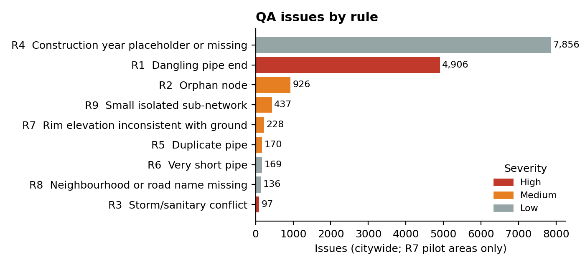
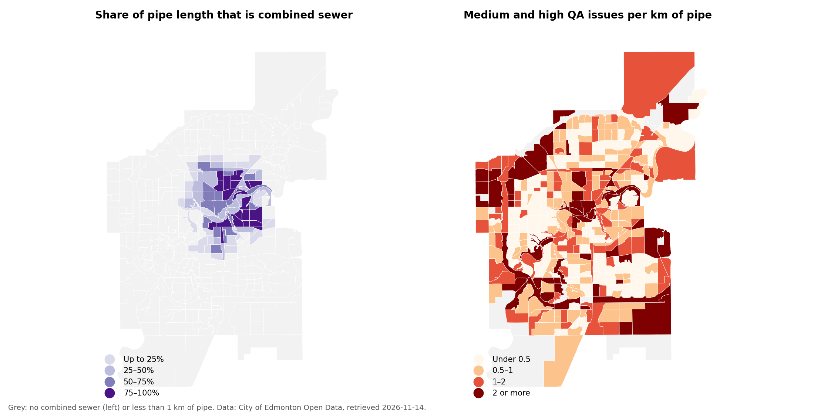

# QA report, 2026-11-14

Run of `scripts/c3_qc_rules.py` on City of Edmonton drainage data retrieved 2026-11-14. Rules and thresholds: `docs/qa_rules.md`.

## Summary
- **14,925 issues on 14,264 assets**: 5,003 high, 1,761 medium and 8,161 low severity.
- The network is **mostly well connected**. 83% of pipe ends sit on a node and another 15% end on another pipe. Only **4,906 ends (1.8%)** meet nothing within 0.5 m.
- The largest data gap is **construction year**: 7,856 assets carry a placeholder (0 or 9999) or no year, mostly catch basins and their leads.
- In Terwillegar Towne, **rim elevations are systematically lower than the 2019 ground surface**: 89% of the flagged differences are negative, typically 1.1 to 1.8 m below ground, and they cluster along particular streets. That pattern points to a source to check (for example design versus as-built elevations, or later regrading) rather than random errors.

| Rule | Severity | Issues | Assets | Ottewell | Terwillegar Towne |
|---|---|---|---|---|---|
| R1 Dangling pipe end | High | 4,906 | 4,824 | 31 | 48 |
| R3 Storm/sanitary conflict | High | 97 | 95 | 0 | 0 |
| R2 Orphan node | Medium | 926 | 926 | 13 | 4 |
| R5 Duplicate pipe | Medium | 170 | 170 | 0 | 0 |
| R7 Rim elevation vs ground | Medium | 228 | 228 | 29 | 199 |
| R9 Isolated sub-network | Medium | 437 | 437 | 10 | 8 |
| R4 Construction year | Low | 7,856 | 7,856 | 207 | 19 |
| R6 Very short pipe | Low | 169 | 169 | 5 | 0 |
| R8 Names missing | Low | 136 | 136 | 0 | 0 |

Pilot counts include the margin of about 280 m around each neighbourhood.

## Findings by rule
- **R1 dangling ends (4,906).** Storm 3,234, sanitary 1,301, combined 351. Half are within 14 m of a node and three quarters within 33 m, so many look like pipes that stop short of a manhole in the drawing. Some will be real stubs.
- **R3 storm/sanitary conflicts (97).** 54 sanitary and 43 storm pipe ends meet only the other system. These are worth checking first, because a real cross-connection sends sewage to a creek or stormwater to the treatment plant.
- **R2 orphan nodes (926).** 727 manholes have no pipe and 199 catch basins have no lead.
- **R5 duplicates (170)** and **R6 short pipes (169)** are typical digitizing artefacts and quick to fix.
- **R7 rim elevations (228, pilot areas).** 57 rims are missing or near zero (one manhole records 6,192 m above ground, likely a typing error). The rest differ from ground by more than 1 m; see the Terwillegar Towne pattern above.
- **R9 isolated groups (437 pipes).** The network falls into 1,017 connected groups. The largest holds 100,742 pipes (5,805 km). Storm groups that end in a pond, at an outfall or at a pump station are treated as connected; 437 pipes sit in groups of fewer than five with none of these.
- **R4 construction year (7,856).** Catch basin leads 2,645, catch basins 2,525, pipes 1,342, manholes 1,339.

## Where issues concentrate
Medium and high severity issues per km of pipe are highest in river valley and ravine areas and in several industrial and edge areas of the city, where pipes are fewer and more often end at outfalls, ponds or the city limit. Older central neighbourhoods, despite their age, mostly have low issue density; their main gap is construction year.

## Pilot areas
| | Ottewell | Terwillegar Towne |
|---|---|---|
| Pipes built (middle half, median) | 1959–1975, 1961 | 2000–2005, 2003 |
| Pipe length in pilot area | 99.6 km | 83.1 km |
| System mix (by length) | combined 64%, storm 26%, sanitary 10% | storm 52%, sanitary 47%, foundation drain 1% |
| QA issues | 295 | 278 |
| Main issue | construction year placeholders (207) | rim elevations (199) |

The two pilots have different problems: the older neighbourhood's gaps are in attributes, the newer one's in elevations.

## Next steps for review
1. Review R3 and R1 in the web app, starting with ends more than 5 m from a node.
2. Check the Terwillegar Towne rim elevations against as-built drawings or a survey sample.
3. Fix R5 duplicates and R6 short pipes in one editing pass.
4. Replace year placeholders with a documented "unknown" value and an estimated era where drawings allow.

Each issue has a `review_status` field, so a reviewer can mark it confirmed, fixed or not an issue.
