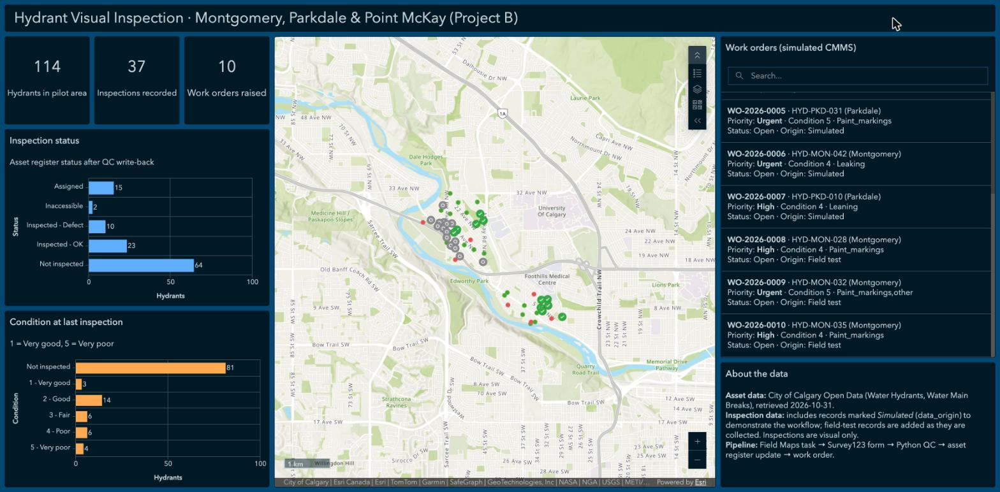

# Calgary Water Network: Asset Management with GIS

A portfolio of GIS work on the City of Calgary's water distribution network, built entirely from City of Calgary Open Data. It follows the asset management cycle: understand where the risk is, inspect the assets in the field, and plan renewal.

**Author:** Jieni Zhao, M.Sc. in Geographic Information Systems, University of Calgary

## Projects

| Project | What it does | Status | Tools |
|---|---|---|---|
| **Water Main Risk & Community Vulnerability** | Scores every water main by material, age and diameter, maps how risk is distributed, and relates it to community vulnerability (seniors and young children) with local bivariate relationships, so preventive maintenance can be planned ahead of failures. | Complete (GEOG 588, 2026) | ArcGIS Pro, ArcGIS Dashboards, ArcGIS StoryMaps |
| **[Project B: Hydrant inspection, from field task to work order](ProjectB/)** | An end-to-end inspection workflow for 114 hydrants: a prioritized asset register, Field Maps tasks that open pre-filled Survey123 forms, a Python QC script that updates the register and raises work orders, and an operations dashboard. Field-tested on 2026-11-03. | Complete | ArcGIS Online, Field Maps, Survey123, ArcGIS Notebooks (ArcGIS API for Python), ArcGIS Dashboards |
| **[Project A: Water main mini AMP](ProjectA/)** | Moves the risk analysis from an area-wide pattern to each pipe segment: likelihood of failure from recorded breaks, consequence of failure, risk = LoF × CoF, levels of service, and a 20-year renewal and funding forecast in the format of a municipal asset management plan. | In progress | FME Form, QGIS, Python (pandas), Excel, Power BI |

- StoryMap for the original project: <https://arcg.is/1ieXnq6>



## Repository layout
```
├── ProjectB/   # hydrant inspection workflow: README, SOP, data dictionary, QC reports, scripts, screenshots
└── ProjectA/   # mini AMP (in progress): data inventory and work log
```
Each project has its own README. Decision records and daily work logs are kept in Chinese; everything written for readers is in English.

## Data and licences
- Data: City of Calgary Open Data, under the Open Government Licence – City of Calgary. OpenStreetMap data is © OpenStreetMap contributors, under the ODbL.
- Large raw downloads are not stored here. Each project's data README explains how to download them again from the Open Calgary API.
- Inspection records marked `Simulated` are demonstration data and are labelled as such everywhere they appear.
- This is independent portfolio work. It is not a City of Calgary product or procedure.
